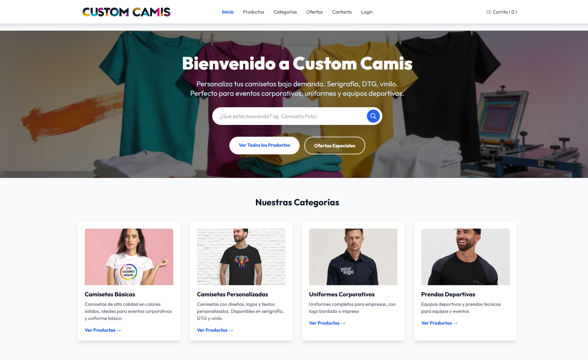

# MyShop - Custom Camis



Una aplicación de comercio electrónico desarrollada en Laravel para la gestión y venta de camisetas personalizadas. Permite a los usuarios explorar productos, gestionar su carrito de compras y simular la finalización de la compra (el checkout solo vacía el carrito), mientras ofrece a los administradores un panel de administración para gestionar productos y listar usuarios.

## Demo en vivo

Puedes probar la aplicación desplegada en Laravel Cloud:

[Demo de Custom Camis](https://laravel-myshop-custom-camis-production-vq5frf.laravel.cloud)

En la demo se puede recorrer el catálogo y las categorías, consultar la ficha de cada producto con sus tallas, usar el carrito con la oferta de descuento por volumen (a partir de 100 unidades) y otras promociones por producto y enviar el formulario de contacto.

El registro de usuarios está cerrado en la demo. Las credenciales de acceso se facilitan en privado y se pueden solicitar a través del [portfolio](https://vicente-codes-portfolio-web.vercel.app/proyectos/custom-camis).

### Limitaciones de la demo

*   Los datos son de ejemplo.
*   El formulario de contacto no envía correos: el mensaje solo se registra en los logs del servidor.
*   Las imágenes subidas desde el panel de administración no persisten entre despliegues, por lo que no debe usarse esa subida en la demo.
*   La demo pide a los buscadores que no la indexen (noindex).

## Demo visual

Puedes consultar un recorrido visual de la aplicación en la página de detalle de Custom Camis:

▶️ [Ver recorrido de Custom Camis](https://vicente-codes-portfolio-web.vercel.app/proyectos/custom-camis)

## Tecnologías Utilizadas

Este proyecto utiliza un stack moderno basado en PHP y JavaScript:

*   **Backend:**
    *   **PHP:** 8.4 o superior
    *   **Laravel Framework:** 12
    *   **MySQL:** Base de datos relacional (8.0 con Sail).
*   **Frontend:**
    *   **Blade:** Motor de plantillas de Laravel.
    *   **Tailwind CSS:** Framework de utilidades CSS para el diseño (3.x).
    *   **Alpine.js:** Framework JavaScript ligero para interactividad (3.x).
    *   **Vite:** Herramienta de construcción y desarrollo frontend (7.x).
    *   **Node.js:** Entorno de ejecución para el frontend (22).
*   **Herramientas de Desarrollo:**
    *   **Laravel Sail:** Entorno de desarrollo local basado en Docker.
    *   **Composer:** Gestor de dependencias de PHP.
    *   **NPM:** Gestor de paquetes de Node.js.

## Estructura del Proyecto

La estructura sigue el estándar de Laravel, destacando los siguientes directorios:

*   `app/Http/Controllers`: Contiene la lógica de negocio (ProductController, CartController, etc.).
*   `app/Models`: Modelos Eloquent que representan las tablas de la base de datos (Product, User, Category, Offer).
*   `database/migrations`: Definiciones del esquema de la base de datos.
*   `database/seeders`: Datos de prueba iniciales (el modo demo crea un usuario administrador).
*   `resources/views`: Plantillas Blade para el frontend (productos, carrito, admin).
*   `routes/web.php`: Definición de todas las rutas de la aplicación.

## Requisitos Previos

Para ejecutar este proyecto en local necesitas tener instalado:

*   **PHP:** Versión 8.4 o superior.
*   **Composer:** Última versión estable.
*   **Node.js & NPM:** Node.js 22 y NPM (Vite 7 requiere Node ^20.19 o >=22.12).
*   **Docker Desktop:** Recomendado para usar Laravel Sail (base de datos y servicios listos para usar).
*   **MySQL:** Si no usas Docker, necesitas un servidor MySQL local.

## Instrucciones de Instalación

Sigue estos pasos para desplegar el proyecto en tu máquina local:

1.  **Clonar el repositorio:**
    ```bash
    git clone <URL_DEL_REPOSITORIO>
    cd MyShop
    ```

2.  **Instalar dependencias de PHP:**
    ```bash
    composer install
    ```

3.  **Configurar variables de entorno:**
    ```bash
    cp .env.example .env
    php artisan key:generate
    ```

    `.env.example` usa SQLite por defecto (`DB_CONNECTION=sqlite`), mientras que Sail levanta un servicio MySQL. Para usar Sail, define estas variables en `.env` antes de arrancar los contenedores:

    ```dotenv
    DB_CONNECTION=mysql
    DB_HOST=mysql
    DB_PORT=3306
    DB_DATABASE=myshop
    DB_USERNAME=sail
    DB_PASSWORD=password
    ```

4.  **Iniciar el entorno (Opción con Docker/Sail):**
    ```bash
    ./vendor/bin/sail up -d
    ```

5.  **Ejecutar migraciones y seeders (Importar BD y datos de prueba):**
    ```bash
    # Con Sail
    ./vendor/bin/sail artisan migrate --seed
    
    # Sin Sail
    php artisan migrate --seed
    ```

    En local, `migrate --seed` mantiene el camino antiguo: crea un usuario demo y dos usuarios aleatorios con las credenciales de desarrollo del seeder/factory; ninguno recibe rol de administrador. Las credenciales locales no se publican en este README.

    En producción, `migrate --seed` no siembra datos por defecto. Para una demo, define `ALLOW_DEMO_SEED=true`, `DEMO_ADMIN_PASSWORD` y `DEMO_CUSTOMER_PASSWORD` como secretos (mínimo 12 caracteres), ejecuta `php artisan migrate --seed --force` y después vuelve a poner `ALLOW_DEMO_SEED=false`. El modo demo crea un administrador y un cliente; los emails están en `config/demo.php`.

6.  **Instalar y compilar dependencias de Frontend:**
    ```bash
    npm install
    npm run dev
    ```

## Uso Básico

Una vez iniciada la aplicación, puedes acceder a ella desde tu navegador:

*   **URL Principal:** `http://localhost` (o el puerto configurado).
*   **Navegación:** Explora el catálogo de productos, filtra por categorías y añade items al carrito.

### Acceso de Prueba (Admin / Usuario)
Las credenciales de prueba no se publican en este README. En local, `migrate --seed` mantiene el camino antiguo; en producción/demo, el acceso se configura con `ALLOW_DEMO_SEED`, `DEMO_ADMIN_PASSWORD` y `DEMO_CUSTOMER_PASSWORD`.

## Despliegue

La demo se despliega en Laravel Cloud con PHP 8.4 y Node 22.

Comandos de build:

```bash
composer install --no-dev --optimize-autoloader --no-interaction
npm ci
npm run build
php artisan config:cache
php artisan route:cache
php artisan view:cache
```

Comando de despliegue:

```bash
php artisan migrate --force
```

Variables de entorno que hay que definir:

*   `APP_KEY`: clave de cifrado de la aplicación.
*   `ALLOW_DEMO_SEED`: activa la siembra de datos de demo.
*   `DEMO_ADMIN_PASSWORD`: contraseña del usuario administrador de la demo (mínimo 12 caracteres).
*   `DEMO_CUSTOMER_PASSWORD`: contraseña del usuario cliente de la demo (mínimo 12 caracteres).
*   `REGISTRATION_ENABLED`: abre o cierra el registro público de usuarios.
*   `DEMO_NOINDEX`: añade la cabecera y la metaetiqueta `noindex` para que la demo no sea indexada.
*   `CONTACT_RECIPIENT`: destinatario del formulario de contacto.
*   `SESSION_SECURE_COOKIE`: limita las cookies de sesión a conexiones HTTPS.
*   `SESSION_DRIVER=database`: almacena las sesiones en la base de datos.

Laravel Cloud inyecta por sí mismo algunas variables (APP_ENV, APP_DEBUG, APP_URL, y las de conexión a la base de datos al asociarla al entorno).

La siembra de la demo se ejecuta una sola vez desde la consola de Laravel Cloud con `php artisan db:seed --force`, después de definir `ALLOW_DEMO_SEED=true` y las contraseñas de demo. Al terminar, vuelve a poner `ALLOW_DEMO_SEED=false`.

## Autores y Créditos

*   **Vicente** - Desarrollador Principal - [GitHub](https://github.com/Vicente-codes)

*Agradecimientos a la comunidad de Laravel por su increíble documentación y recursos.*

## Licencia

Este proyecto es para **Uso Educativo**.

---
*Este proyecto fue desarrollado como parte de un ejercicio académico/práctico.*
